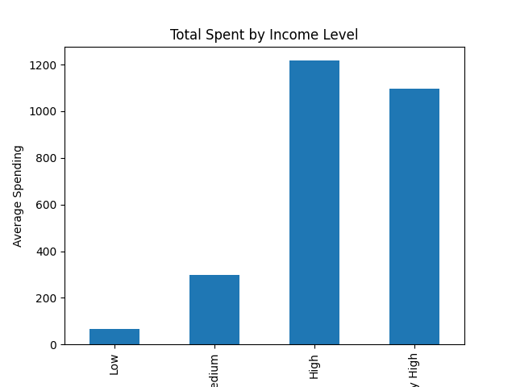
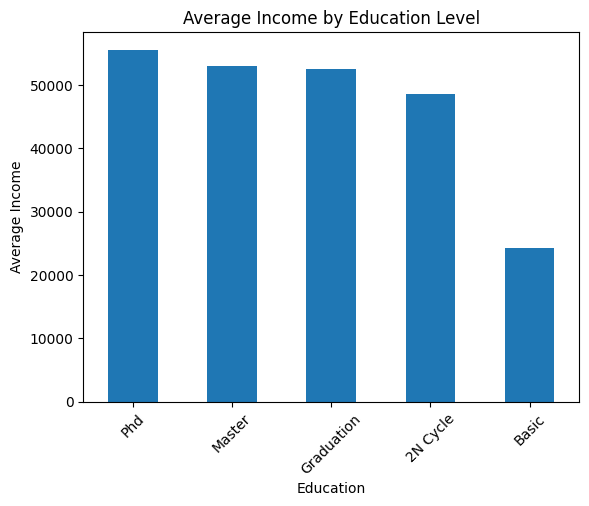

#  Mini Data Cleaner & Customer Analysis

##  Description

End-to-end data cleaning and customer segmentation project built with Python and pandas.

This project demonstrates how raw, unstructured data can be transformed into clean, analysis-ready datasets and leveraged to generate actionable business insights through exploratory data analysis (EDA).

---

##  Features

* Data cleaning (missing values, duplicates, formatting)
* Outlier detection and handling (Income anomalies)
* Feature engineering:

  * Age
  * Total_Spent
  * Children
  * Customer_Days
* Customer segmentation (income levels, demographics)
* Exploratory Data Analysis (EDA)
* Data visualization for insight generation

---

##  Tech Stack

* Python
* Pandas
* Matplotlib
* Jupyter Notebook

---

##  ETL Pipeline

###  Extract

* Load raw dataset from CSV source

###  Transform

* Data cleaning and normalization
* Missing value handling (median imputation)
* Outlier detection using business rules and statistical methods
* Feature engineering to enhance analytical capabilities

###  Load

* Export processed dataset to a clean CSV file for downstream use

---

##  Key Insights

* Higher education levels (PhD, Master) correlate with higher income
* High-income customers contribute significantly more to total revenue
* Married customers show higher average spending behavior
* Customer segmentation enables identification of high-value segments for targeted marketing

---
##  Data Visualization

### Income vs Spending



### Education vs Income


### Marital Status vs Spending


##  Project Structure

```
data_cleaner/
│
├── data/
│   ├── raw.csv
│   └── clean.csv
│
├── notebook.ipynb
└── README.md
```

---

##  How to Run

1. Install dependencies:

```
pip install pandas matplotlib
```

2. Launch Jupyter Notebook:

```
jupyter notebook
```

3. Run all cells inside `notebook.ipynb`

---

##  Business Value

This project showcases how data pipelines can support:

* Customer segmentation strategies
* Marketing optimization
* Revenue analysis
* Data-driven decision making

---

##  Future Improvements

* Convert pipeline into a CLI tool
* Automate data validation and reporting
* Integrate with SQL databases
* Build an interactive dashboard (Streamlit)

---

## 👨‍💻 Author

Felipe
Junior Data Engineer | Backend Developer (Python) 🚀
